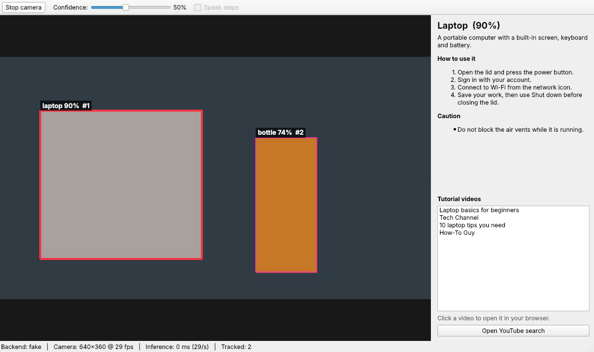

# FieldGuide

Point your webcam at an object. FieldGuide boxes and names it, and when you click the box it shows
**how to use the object** (steps and cautions) and **YouTube tutorials** for it, in real time.
Detection runs on your own machine (YOLO11 + ByteTrack). Video never leaves the computer; only a short
text search phrase is sent to YouTube when you select an object (and only if you set an API key).



## Quick start (Arch Linux)

```bash
sudo pacman -S python python-pip espeak-ng      # espeak-ng is only for spoken steps
cd FieldGuide
python -m venv .venv
source .venv/bin/activate
pip install -r requirements.txt
cp .env.example .env                            # optional: add your YouTube key in .env
python -m fieldguide --start
```

Or simply run `scripts/run.sh --start` (creates the virtual environment on first use).
On first start Ultralytics downloads `yolo11n.pt` (internet needed once).

If the window does not open on Wayland: `export QT_QPA_PLATFORM=xcb`.
If the camera is denied: `sudo usermod -aG video $USER`, then log out and in.
CPU-only machine and a huge download? Install the small build first:
`pip install torch torchvision --index-url https://download.pytorch.org/whl/cpu` and then the requirements.

## Using it

| Action | How |
|---|---|
| Start / stop camera | Toolbar button or `Ctrl+R` |
| Select an object | Click its box (solid box = stable; dashed = still settling) |
| Clear selection | Click empty space or `Esc` |
| Change sensitivity | Confidence slider (lower finds more, higher is stricter) |
| Hear the steps | Tick "Speak steps" (needs `pyttsx3` + espeak-ng) |
| Open a tutorial | Click it in the list; "Open YouTube search" opens a normal search page |
| Use a video file | `python -m fieldguide --video clip.mp4` |
| Other webcam | `python -m fieldguide --camera 1` |

The status bar shows backend (cpu/cuda), camera resolution and fps, inference time and rate, and tracked objects.

## YouTube tutorials

1. In Google Cloud Console create a project, enable **YouTube Data API v3** and create an API key.
2. Copy `.env.example` to `.env` and put your key in `YOUTUBE_API_KEY`. The app loads this file automatically. Never commit `.env`.
3. Results are cached in `data/cache.sqlite3` for `cache_days` days to save quota.
No key, no internet or quota used up? You still get the local steps, plus a button that opens a YouTube search.

## Fixing wrong labels (e.g. a Monster can called "bottle")

The default model only knows the 80 COCO classes, and COCO has no "can". Fine-tune a model with your own photos:
see the instructions at the top of `scripts/train_custom.py`. Then copy `best.pt` next to `config.toml`,
set `model = "best.pt"`, and the `energy_drink_can` entry in the knowledge base is used automatically.
Quicker partial fixes: raise `imgsz` to 640, lower `conf`, or try `yolo11s.pt`.

## Adding guidance for more objects

Edit `data/knowledge_base.json`. Each entry needs `label` (the exact detector class name) and at least one step:

```json
{"label": "laptop", "display_name": "Laptop", "category": "electronics",
 "summary": "...", "steps": ["..."], "cautions": ["..."],
 "tutorial_queries": ["how to use a laptop for beginners"],
 "curated_videos": [{"video_id": "abc123", "title": "My favourite", "channel": "Someone"}]}
```
Curated videos are always shown first. Invalid entries are skipped with a warning in the terminal.

## Measuring performance (for your report)

```bash
python -m fieldguide.benchmark --video clip.mp4 --frames 300
```
Prints mean and 95th-percentile inference time, frames per second, and how many label changes happened
with and without label voting.

## Tests

```bash
pytest -q          # 41 tests; the UI tests run headless (QT_QPA_PLATFORM=offscreen)
```
The tests use a fake detector, so they need no camera or model download.

## Folder structure

```
FieldGuide/
  config.toml                 settings (thresholds, camera, paths)
  requirements.txt
  data/
    knowledge_base.json       instructions per object
    custom_dataset.example.yaml
  fieldguide/
    __main__.py  app.py       entry point and start-up
    pipeline.py               starts/stops the capture and inference threads
    capture.py                webcam / video reader thread
    detector.py               YOLO + ByteTrack, and the inference thread
    stabiliser.py             label voting, box smoothing, "stable" flag
    guidance.py               knowledge-base loading and lookup
    tutorials.py              YouTube search, SQLite cache, fallback link
    speech.py                 optional spoken steps
    config.py  models.py  slots.py  geometry.py  benchmark.py
    ui/ main_window.py video_widget.py side_panel.py
  scripts/ run.sh  train_custom.py
  tests/
```

## How it stays smooth

Capture, inference and the interface run in separate threads. Each shared slot holds only the newest item,
so a slow detector skips frames instead of queueing them and the video never freezes. The overlay is redrawn
~33 times a second from the latest result.

## Licence note

Ultralytics YOLO is AGPL-3.0 (commercial licence available). Fine for a university project; review it before distributing.


## GitHub and large files

Commit the source code, tests, configuration, and `.env.example`. Do not commit `.env`,
`.venv/`, downloaded `.pt` model weights, training output, local datasets, or cache databases.
These are excluded by `.gitignore`. The default YOLO weights are downloaded by Ultralytics
when the app first runs. If you need to distribute a custom trained model, host it separately
or use Git LFS rather than committing a multi-gigabyte file.
